<pre><picture><source media="(max-width: 600px)" srcset="Assets/profile/monitor-top-mobile.svg" /></picture>
<picture><source media="(max-width: 600px)" srcset="https://readme-typing-svg.demolab.com?font=JetBrains+Mono&amp;weight=500&amp;size=15&amp;pause=1000&amp;color=A7C9AA&amp;center=true&amp;vCenter=true&amp;width=420&amp;height=36&amp;lines=Android+Kernel+%26+ROM+Developer%3BArch+Linux+%7C+Hyprland+%7C+Zed%3BAI+%26+Data+Science+Undergrad+%282028%29%3BOpen+Source+%7C+SDDM+Themes+%7C+Kernel+Work%3BBuilding+for+the+Long+Game." /></picture>
  
<a href="https://xcaptain09.github.io/portfolio/"><picture><source media="(max-width: 600px)" srcset="Assets/profile/monitor-link-portfolio-mobile.svg" /></picture></a> <a href="https://t.me/xCaptain_09"><picture><source media="(max-width: 600px)" srcset="Assets/profile/monitor-link-telegram-mobile.svg" /></picture></a> <a href="https://github.com/xCaptaiN09/Sortify"><picture><source media="(max-width: 600px)" srcset="Assets/profile/monitor-link-sortify-mobile.svg" /></picture></a>
<a href="https://github.com/xCaptaiN09/pixie-sddm"><picture><source media="(max-width: 600px)" srcset="Assets/profile/monitor-link-pixie-mobile.svg" /></picture></a> <a href="https://github.com/xCaptaiN09/glyph-sddm"><picture><source media="(max-width: 600px)" srcset="Assets/profile/monitor-link-glyph-mobile.svg" /></picture></a> <a href="https://github.com/xCaptaiN09/echo-sddm"><picture><source media="(max-width: 600px)" srcset="Assets/profile/monitor-link-echo-mobile.svg" /></picture></a>
<a href="https://rmx3031-archive.pages.dev"><picture><source media="(max-width: 600px)" srcset="Assets/profile/monitor-link-archive-mobile.svg" /></picture></a>
<picture><source media="(max-width: 600px)" srcset="Assets/profile/monitor-bottom-mobile.svg" /></picture></pre>

---

| Metrics                                                            | Stats                                                                                                                                                                                                                           |
| :----------------------------------------------------------------- | :------------------------------------------------------------------------------------------------------------------------------------------------------------------------------------------------------------------------------- |
| <picture></picture> |   |

---

<!--

  

---
-->

  

