<pre><picture><source media="(max-width: 1000px)" srcset="Assets/terminal/terminal-top-compact.svg" /></picture>
<a href="https://xcaptain09.github.io/portfolio/"><picture><source media="(max-width: 1000px)" srcset="Assets/terminal/terminal-link-portfolio-compact.svg" /></picture></a><a href="https://t.me/xCaptain_09"><picture><source media="(max-width: 1000px)" srcset="Assets/terminal/terminal-link-telegram-compact.svg" /></picture></a><a href="https://github.com/xCaptaiN09/Sortify"><picture><source media="(max-width: 1000px)" srcset="Assets/terminal/terminal-link-sortify-compact.svg" /></picture></a><a href="https://github.com/xCaptaiN09/pixie-sddm"><picture><source media="(max-width: 1000px)" srcset="Assets/terminal/terminal-link-pixie-compact.svg" /></picture></a><a href="https://github.com/xCaptaiN09/glyph-sddm"><picture><source media="(max-width: 1000px)" srcset="Assets/terminal/terminal-link-glyph-compact.svg" /></picture></a><a href="https://github.com/xCaptaiN09/echo-sddm"><picture><source media="(max-width: 1000px)" srcset="Assets/terminal/terminal-link-echo-compact.svg" /></picture></a><a href="https://rmx3031-archive.pages.dev"><picture><source media="(max-width: 1000px)" srcset="Assets/terminal/terminal-link-archive-compact.svg" /></picture></a>
<picture><source media="(max-width: 1000px)" srcset="Assets/terminal/terminal-fetch-compact.svg" /></picture>
</pre>

---

| Metrics                                                            | Stats                                                                                                                                                                                                                           |
| :----------------------------------------------------------------- | :------------------------------------------------------------------------------------------------------------------------------------------------------------------------------------------------------------------------------- |
| <picture></picture> |   |

---

<!--

  

---
-->

  

---

  <picture>
    <source media="(max-width: 600px)" srcset="Assets/profile/toolbox-footer-mobile.svg" />
    
  </picture>

